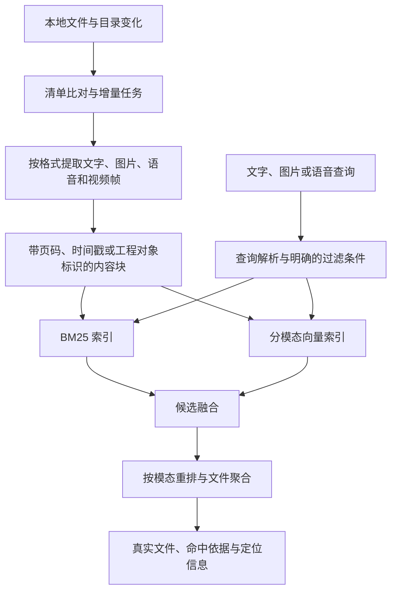

# Free Search 实施方案与决策记录

更新日期：2026-10-21。状态：开发预览版已实现，完成真实文档试点评测、十万合成文件增量验证、额外真实媒体功能检查及双版 EXE 本地推理验证。最终发行验收尚未全部完成。实测汇总与边界见 [验证记录](VALIDATION.md)。

本文记录已确认的要求、建议方案和待决事项。候选技术与性能目标不代表已完成验证。

## 1. 已确认的目标与环境

- 交付 Windows EXE 搜索工具，分别提供完全离线版和可调用 API 的版本。
- 主要任务是找到本机真实文件，结果必须能够定位和打开原文件，并提供匹配依据。
- 检索内容包括文档、图片、录音、视频、源码工程和专业软件工程文件。
- 输入包括文字、以图搜图和语音提问。
- 使用 BM25、向量检索、时间／类型／路径过滤，并进行二阶段重排。
- 文件变化触发增量索引：十万文件只修改三个时，不能重新解析、生成全部文件的向量或重建全部内容索引。
- 至少提供 50 条真实查询及期望文件，主要以用户电脑上的真实资料进行私有本地评测。
- API 版默认在本地处理，文本／图片／音视频外发需要用户逐项授权。
- 首发验收机器：Windows 11，16GB 内存，AMD Ryzen 7 7840H，NVIDIA GeForce RTX 4060 Laptop GPU，8GB 显存。
- 开发目录由用户指定；开始时为空目录。
- 首批必备格式：PDF、DOCX、PPTX、TXT、PNG、JPG；源码样本由开发过程在授权范围内查找。
- 录音首版先检索讲话内容；允许调用本机已安装软件导出预览或文本。
- 首轮文档和截图目录已由用户指定，无排除目录；具体路径记录于被忽略的 `private/project-settings.json`。
- 全部工作记录、私有评测、索引与构建产物保存在本工作目录下，公开上传包单独生成并排除私有数据。

## 2. 编码前需要确定的范围

| 待决事项 | 为什么影响实现 | 当前处理 |
| --- | --- | --- |
| 工程文件的具体软件、扩展名与版本 | 源码可直接读取；DWG、RVT、PSD、EDA 等需要不同解析器或原软件导出能力 | 首批必备格式已确定为通用文档和图片；清单发现 DWG 候选样本，将验证其解析范围，不据此承诺全部专有工程格式 |
| 是否允许调用已安装的专业软件 | 一些专有格式只能通过软件提供的接口或导出功能获得内容 | 用户已允许调用已安装软件；付费 SDK 和额外购买仍需另行确定 |
| 首轮试点及私有评测目录、排除目录 | 决定真实样本与可读范围，也避免将私人材料误写入公开仓库 | 两个目录已确定，无排除目录；65 个真实文档的内容解析与52条查询试点评测已完成，全部明细保留本机 |
| 音频语义是否包含环境声音和音乐 | 语音转写可检索讲话内容；狗叫、机械噪声和音乐需要另外的音频表征与评测 | 已确认首版先覆盖讲话内容，环境声音／音乐检索不列为首版必备能力 |
| API 首发服务商、所用能力与预算 | 聊天、向量、视觉、转写、重排不是同一接口；服务商支持范围不同 | 不预设收费服务；到 API 阶段前确定 |
| 工程源码的开源许可证 | 影响后续代码使用与分发说明 | 用户已授权按建议实施，源码采用 MIT；第三方及模型许可单独记录，最终发行前核对 |

“两类工程文件都需要”已确认，但不等于已经确定所有工程格式。首批通用格式与发现的工程样本写入能力清单，每项列明：内部文本、结构化字段、预览画面、元数据分别支持到什么程度。不支持内容读取的格式应明确显示状态，不能算作已支持语义搜索；DWG 等专有格式属于单独的技术验证项。

## 3. 产品与交付边界

### 3.1 两个版本，共用检索核心

| 项目 | 完全离线版 | API 版 |
| --- | --- | --- |
| 首次启动 | 程序和所需模型准备齐全后，在无网络的新环境中运行 | 默认使用本地处理；用户自行配置服务 |
| 索引存储 | 本地 | 本地 |
| OCR、转写、向量和重排 | 使用本地模型 | 本地能力加上经过授权的 API 能力 |
| 网络访问 | 禁用更新检查、遥测、在线模型检查和隐式下载 | 根据用户授权发送指定类型、范围的内容 |
| 模型缺失 | 明确说明缺少哪个离线组件，不能后台联网补齐 | 提示可用能力及配置状态 |

离线版必须提供可实际搬到断网机器使用的模型包。仅提供“首次联网下载模型、之后可以离线”的程序不能作为完整离线交付。

API 授权应同时明确服务商、发送的内容类型和文件范围。首次批量任务应展示处理量和可估算的费用；设置请求／用量上限。API 密钥存入 Windows 凭据存储，不进入源码、日志或评测数据。

外部向量模型与本地向量模型的文档、查询必须使用同一个模型及预处理版本。切换模型需要建立对应索引，不允许用 API 查询向量直接搜索另一模型建立的索引。API 暂时失败时，只能切回兼容的本地索引，不能静默混用向量。

### 3.2 全盘覆盖与处理状态

- 提供全盘选择和指定目录选择；优先在试点目录验证后扩展到各盘。
- “全盘”表示用户选择范围内、当前账号有权读取且解析器支持的本地文件。
- 第一轮必须建立内容索引，期间持续展示已发现、待处理、成功、失败、不支持及跳过的数量。
- 系统保护目录、权限不足、加密文件、占用文件、损坏文件及仅在云端的占位文件分别报告；不能把文件名登记成功当作内容解析成功。
- 文件名和路径可先检索；多模态内容处理完成后再进入对应的内容检索。
- 本程序只读取源文件并维护自身索引；解析源码不执行源码，读取 Office 文件不运行宏。

### 3.3 EXE 交付形式

建议先交付含 `FreeSearch.exe` 的便携目录压缩包，运行依赖与模型作为同级目录提供，再考虑安装器。用户不需要安装 Python、Node、Docker 或数据库服务。

不优先把数 GB 模型塞进单个 EXE。PyInstaller 的单文件形式会在启动时将运行文件解压到临时目录，官方也建议先验证目录形式。[PyInstaller 工作原理](https://pyinstaller.org/en/stable/operating-mode.html)

实际程序、模型和显卡运行库体积在技术验证阶段测量；当前不承诺安装包大小。显卡驱动属于目标机器前提，程序要能检测 GPU 是否可用，并提供较慢的 CPU 路径。

## 4. 建议架构

建议从 Python + PySide6 原生桌面界面开始，模型和解析任务放在后台工作进程，SQLite 管理清单与任务，SQLite FTS5 提供 BM25，嵌入式 LanceDB 保存向量和过滤字段。这样可直接使用本地多模态生态，同时避免另行部署数据库服务。



Qt 官方提供 PySide6 与 PyInstaller 的部署说明；具体依赖版本在验证可打包后锁定。[Qt 部署参考](https://doc.qt.io/qtforpython-6/deployment/deployment-pyinstaller.html)

SQLite FTS5 提供 BM25 和增删改能力；中文需明确进行分词，英文缩写、代码标识符和文件名保留适合精确匹配的词项，不能直接依赖默认英文式切词。[FTS5 文档](https://www.sqlite.org/fts5.html)

LanceDB 是候选的本地嵌入式向量库，支持元数据预过滤及按键更新。只有通过 Windows 增量更新、查询和 EXE 打包验证后才固定使用。[LanceDB 项目](https://github.com/lancedb/lancedb)、[过滤](https://docs.lancedb.com/search/filtering)、[更新](https://docs.lancedb.com/tables/update)

SQLite 与向量库之间需要可恢复的任务记录和内容版本标识，避免一次中断造成文字已更新、向量仍过期。只在同一文件的新版本已完整写入后使其生效；失败任务可幂等重试。

不增加聊天回答、联网搜索、远程服务器或训练模型等额外功能。搜索结果首先服务于定位和打开原文件。

## 5. 各模态的实现与取舍

| 内容／输入 | 建议处理 | 验收依据 |
| --- | --- | --- |
| 文本、源码、配置与结构化文本 | 提取文字和结构，按段落或代码边界分块 | 文件、行号或片段，覆盖中文和技术术语 |
| PDF | 优先原生文字提取；扫描页做 OCR；必要时索引页面图像 | 文件和页码；扫描件单独评测 |
| Office 文档 | 分格式提取段落、表格、工作表和幻灯片内容 | 对应段落、工作表或页号 |
| 图片 | OCR 加视觉向量，分别覆盖截图文字与照片场景 | 图像预览、OCR 区域或视觉匹配依据 |
| 录音 | 语音转写，保存片段时间戳 | 命中原音频的时间区间 |
| 视频 | 音轨转写加场景变化抽帧、间隔补采样和帧 OCR | 命中时间及帧预览；无对白的视频也有评测 |
| 工程文件 | 对确认格式提取对象名称、图层、属性、材料、文本和可用预览等 | 区分结构化属性命中与仅预览画面命中 |
| 图片查询 | 使用与图片索引相同的视觉模型，可补充图片 OCR 文字 | 验证相似语义，排除评测查询图自身造成的虚高结果 |
| 语音提问 | 本地转写，界面显示识别文字后进入查询链路 | 同时记录识别质量与最终文件命中 |

视频抽帧不能保证覆盖每个极短事件，专业工程文件的预览也不能代替内部结构读取。这两点必须体现在能力清单与失败案例中。先评测抽帧覆盖与成本，再决定是否对候选片段进行更密集分析。

复杂 PDF／Office 版面可评估 Docling，但不预设把其全部依赖放进首版。[支持格式](https://docling-project.github.io/docling/usage/supported_formats/)

语音转写候选为 faster-whisper；中文必须使用多语言模型，不能误用仅英语的模型。Windows 的 CPU、CUDA 和打包路径都需要实测。[faster-whisper](https://github.com/SYSTRAN/faster-whisper)

### 5.1 离线模型候选

- 文字向量：比较轻量的 multilingual-e5-small 与 BGE-M3，以本机中文检索质量、耗时及内存决定，不默认采用最大的模型。[E5 模型卡](https://huggingface.co/intfloat/multilingual-e5-small)、[BGE-M3 模型卡](https://huggingface.co/BAAI/bge-m3)
- 图片／视频帧向量：比较 Chinese-CLIP 与 SigLIP 2 小规格，使用中文描述和真实照片、截图评测。[Chinese-CLIP](https://github.com/OFA-Sys/Chinese-CLIP)、[SigLIP 2](https://huggingface.co/google/siglip2-base-patch16-224)
- 文字重排：采用中英文交叉编码器候选；只对少量召回候选评分。[BGE 重排参考](https://huggingface.co/BAAI/bge-reranker-v2-m3)
- 纯画面重排：验证 Qwen3-VL-Reranker-2B 等真正支持图片／视频输入的模型在 8GB 显存中的成本。不能用文字重排器假装处理原始画面。[Qwen 多模态重排模型卡](https://huggingface.co/Qwen/Qwen3-VL-Reranker-2B)

以上是候选，不会一次性下载全部模型。16GB 内存和 8GB 显存下按任务加载、限制批量和图像分辨率，并实测 CPU／GPU 峰值。量化是否可用及是否降低检索质量需要单独测量，不能把输出向量量化与模型权重量化混为一谈。

## 6. 混合检索的明确行为

1. 文字或转写查询保留原始意图；时间、文件类型、路径形成结构化过滤条件。自然语言解析出的条件展示给用户，避免错误地过滤目标文件。
2. 在符合过滤条件的范围内分别进行 BM25、文字向量和相关模态向量召回。
3. 文本和视觉模型保存在各自的向量空间，不直接比较不同模型的原始相似度。
4. 用 RRF 等按排名融合的方法合并候选，候选数量在评测中确定。
5. 按模态做二阶段重排；文档保留最佳命中片段，再聚合到文件，避免长文档或长视频占满结果。
6. 结果展示路径、类型、修改时间、命中片段，以及页码／时间戳／帧等证据，并支持打开文件和所在目录。

图片输入有文字时也可进入关键词分支；纯图片输入以视觉分支为主。不能为了让流程图形式统一而对没有文字的图像硬套 BM25。

重排与向量分数属于排序依据，不能直接显示为“90% 正确概率”。评测另外记录无答案查询，检查系统是否把低相关候选误报为明确匹配。

## 7. 增量索引的验收合同

- 清单保存文件标识、路径、大小、修改时间、内容指纹、提取器版本和模型版本。
- 首轮建立清单与索引；后续合并目录通知，只对变化文件创建处理任务。
- 文件元数据用于快速筛查，内容哈希用于确认需要处理的变化；不能每次启动都读取十万个文件的全部内容计算哈希。
- 内容相同的重命名／移动尽量只更新路径等元数据；目录重命名也应更新关联路径。
- 文件删除后使关联文字、向量和预览失效；外置盘离线与实际删除分别处理。
- 中断、程序关闭期间和通知溢出后进行元数据校对，补齐遗漏的变化；校对清单不等于全量重建内容索引。
- 修改长文件时可以先重新解析该文件，再按内容块指纹复用未变化向量；不强求每种格式第一版都实现内部字节级增量解析。
- 更换向量模型、分词规则或提取器版本的迁移应显式说明影响范围，不作为普通文件变更悄悄执行。

目录通知可能因为缓冲区溢出而丢失，微软文档要求相应重新枚举以恢复状态，因此必须有校对机制。[ReadDirectoryChangesW](https://learn.microsoft.com/en-us/windows/win32/api/winbase/nf-winbase-readdirectorychangesw)

核心回归场景：建立十万文件的基准索引，修改三个普通文件，然后检查任务记录与索引摘要。只允许三个文件进入内容解析，向量计算限定于其新增／变化块，其余文件的内容版本和向量保持不变。另测新增、删除、移动、重命名及中断恢复。

向量库自身的数据压缩或局部索引维护与重新解析源文件是不同操作，但普通三文件更新也不能触发完整向量索引重建。必要的大版本迁移单独记录并提供成本说明。

## 8. 私有真实评测

### 8.1 数据与标注

- 在用户选定目录中选择真实存在且允许本地处理的文件，记录相对路径、文件标识、校验和及内容版本。
- 建立至少 50 条有明确期望文件的冻结验收查询，开发调参查询另设；另加不少于 10 条无答案或容易误匹配的对照查询。
- 查询覆盖文档语义、扫描件、照片视觉、无对白视频、录音、源码与已确认的专业工程文件；包含文字、图片和语音输入以及时间／类型／路径条件。
- 按文件真实内容拟写的查询必须注明来源，并由用户复核期望文件；不能宣称这些查询来自真实使用日志，除非实际提供日志。
- 查询避免照抄文件名作为全部答案，加入同义表述、描述不完整、技术缩写及具有相近内容的干扰文件。
- 一条查询可有多个相关文件，标注相关等级及页码／时间戳／对象字段等证据，保留失败案例。
- 冻结集不得用于反复选模型和调参数；开发集与验收集按源文件分离，避免相同内容泄漏。

### 8.2 指标与拟定目标

| 方面 | 必须报告／验证 |
| --- | --- |
| 找文件效果 | 文件级 Hit@1、Hit@5、MRR@10；有完整相关文件标注时报告 Recall@10、nDCG@10 |
| 模态覆盖 | 各类型与各输入方式分别报告，不只提供总平均分 |
| 混合检索收益 | 对比 BM25、仅向量、混合、混合加重排，确认重排实际带来的变化 |
| 过滤正确性 | 所有返回结果满足指定时间、类型、路径条件 |
| 增量正确性 | 十万文件改三个的处理计数、未变化内容摘要、删除与恢复结果 |
| 耗时 | 冷启动／热查询 P50、P95；首批结果和最终重排结果分别记录 |
| 资源与成本 | RAM、显存峰值、索引空间、首次与增量耗时、API 调用及费用 |
| 完全离线 | 干净环境断网首次启动、建索引和各输入查询；检查无隐式联网请求 |

以冻结集 Hit@5 不低于 90% 作为试点目标，同时要求过滤正确性通过全部用例。2026-10-21 的52条真实文档语义查询试点中，混合加文字重排 Hit@5 为47/52（90.38%），查询中位耗时8.254秒。查询由开发代理依据真实内容编写，尚未用户逐条复核；当前结果不代表全盘或多模态准确率，也不完成过滤验收。完整指标与分位口径见 [验证记录](VALIDATION.md)。延迟和资源上限仍需依据更多技术验证定稿，文字与图片／视频重排分别设置预算。

不能只用“十万文件”描述压力测试：还需固定内容块数、图片数、媒体时长和文件大小分布。初步增加约百万内容块量级的测试点；性能样本允许使用清晰标记的合成数据，不能把合成数据算进真实查询验收集。

### 8.3 私有数据与公开仓库分开

真实原文件、绝对路径、查询、期望文件表、索引、转写、OCR 文本及缩略图默认只留本机。按照用户指定，工作记录全部保存在 `D:\Free-Search` 下，私有材料集中放入被忽略的 `private/` 等目录。公开仓库提供评测格式、执行器、无敏感内容的测试夹具和经检查的汇总报告；生成源码上传包时明确排除私有目录，不能只依赖 `.gitignore` 防止网页手动上传。

用户可以在自己的机器重跑完整真实评测。其他 GitHub 使用者只能复现公开测试和使用自己的私有语料评测，不能宣称私人数据集本身是公开可复现的。

## 9. 里程碑与验证方式

| 阶段 | 工作 | 验证方式与阶段交付 |
| --- | --- | --- |
| M0 范围和评测准备 | 确认工程格式、样本目录、外发边界；建立能力清单及私有标注规范 | 格式有可获得样本和明确支持层级；形成首批真实查询草案 |
| M1 Windows 技术验证 | 在小范围真实样本跑通 BM25、向量、过滤、重排；验证模型资源和 EXE 打包 | 便携 EXE 在无 Python 环境启动；断网可查询；记录内存、显存和延迟；确定依赖版本 |
| M2 增量检索核心 | 清单、任务队列、分块缓存、索引一致性、文件生命周期与校对 | 先写三文件修改回归，再实现通过；测试新增删除、路径变化、中断和事件遗漏 |
| M3 多模态和工程能力 | OCR、视觉检索、录音、视频、图片输入、语音提问及确定格式的工程解析 | 每种能力有真实样本及可定位证据；复核静音视频和扫描件；建立全部候选评测条目 |
| M4 API 版本 | 接入确定服务商的能力、授权、密钥存储、用量限制和兼容索引 | 未授权零内容外发；验证超时、限流、预算停止及服务不可用行为 |
| M5 验收与发布整理 | 冻结集运行、十万文件压力测试、两种发行包、文档及许可清单 | 提供真实报告、失败案例、干净 Windows 验证记录、SHA256 和可上传仓库的源码包 |

每阶段汇报已通过的检查、未达标项、处理方案和下一步。当前不提供无依据的完成百分比或固定完工日期；M1 后用实际样本给出首次全盘索引耗时估计、最终包体和后续工作量。

## 10. GitHub 仓库与最终产物

以下为计划结构，不表示文件已经全部创建：

```text
Free-Search/
  README.md
  LICENSE
  THIRD_PARTY_NOTICES.md
  pyproject.toml
  <依赖锁定文件>
  .gitignore
  .env.example
  src/free_search/
  tests/
  evaluation/          # 格式、执行器与公开夹具
  docs/               # 架构、能力表、隐私说明、评测报告、构建说明
  scripts/            # Windows 构建和离线模型包准备
  packaging/          # 两种版本的打包配置
  .github/workflows/  # Windows 测试与构建
```

私有评测与运行数据保存在本工作目录下的独立私有子目录，生成源码上传包时明确排除。仓库只提交代码、必要小资源、模型清单及获取／离线准备方法；大型模型、EXE 和完整离线包作为发布附件或独立模型分发产物，不直接塞进 Git 历史。[GitHub 大文件说明](https://docs.github.com/en/repositories/working-with-files/managing-large-files/about-large-files-on-github)

发布前确认程序、Qt、媒体库、解析器和每个模型的许可及可再分发条件，并记录准确版本、来源、模型修订和 SHA256。是否购买代码签名证书属于额外发布决策。

最终提供可由用户自行上传的干净源码目录／压缩包、离线发行包及模型包、API 发行包、构建说明、真实评测报告和已知限制；另外在本机交付含至少 50 条真实查询、期望文件映射及语料清单的私有评测包，与公开源码包分开保存。用户已明确授权创建公开仓库 Misaka-11736/Free-Search，发布 v0.1.0-preview，采用统一离线分卷安装器并提供两个共用模型的入口。付费 API 调用及签名证书购买未授权。

## 11. 当前实际进度

- 已完成范围确认、首发机器核对、只读文件清单、隐私边界、忽略规则和源码 MIT 许可证；用户已授权按关键方案推进实现。
- 已完成开发预览版应用编码、依赖安装与本地模型准备，真实文件内容解析和检索链路已经运行。最新回归记录为45项自动化测试通过，含安装版双入口与跨进程写锁。
- 已完成文档试点：65个真实候选文档成功解析、0个失败、2,295个内容块；52条开发代理依据真实文档内容编写的中文语义查询已冻结并实际运行 BM25、向量、混合无重排、混合文字重排四种模式。期望文件附校验和与正文定位证据，尚待用户逐条复核。
- 已完成十万文件增量逻辑验证：合成实际文件、预置索引、计数向量模型且禁用 ANN 维护的条件下，修改三个只解析三个，模型输入三个，变化内容版本三个。该实验不代表真实多模态首次索引或实际吞吐量。
- 两版最新 EXE 均已完成索引、语义查询、转写和版本识别检查，并移除 Python 环境变量复验；本机采样资源记录已保存，仍缺干净 Windows 与系统断网首启验收。
- 额外解析8张本机图片、1段WAV和1个约7分24秒的视频，10文件成功、0失败；8张原图查询均首位找回自身。这是功能检查，不能作为复杂多模态检索的准确率指标。
- M3/M5尚需补齐图片、录音、视频、语音提问、扫描件、源码、专有工程文件及真实过滤查询的验收覆盖。十条无答案探针已准备，本轮未运行，且尚待人工审定。当前52条集不能作为全模态验收完成的依据。
- 已生成两版完整便携目录、两个程序压缩包、共用模型组件包、带校验值的源码包及干净上传目录；源码包解压后的40项测试及私有信息排除检查通过。离线主窗口的 Qt 依赖冲突已修复。
- M4/M5尚需真实 API 服务验证、原生依赖对应源码与许可核对、干净 Windows 断网验证。用户已授权直接上传公开仓库及预览 Release；采用 GPLv3 媒体组合并附精确对应源码与构建材料。
- 每项已测结果、指标口径和当前局限集中记录于 [验证记录](VALIDATION.md)，私有查询、原始文件路径和逐条结果不进入公开文档。
- 统一分卷安装器已通过本机安装、两个入口本地推理、共用索引和卸载保留用户数据检查。应用源码及依赖对应源码准备为独立 Release 附件；原生 DLL、权重和许可原文有哈希及来源记录。最终公开发行按 v0.1.0-preview 定位，未完成范围继续披露。
